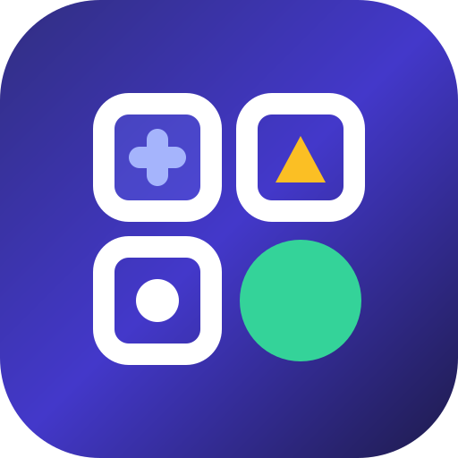

<div align="center">



# CEREBRA

### The 10,000-Level Cognitive Training & Deductive Intelligence Platform

**10 Distinct Cognitive Disciplines · 10,000 Deterministic Levels · 10 Mastery Tiers · Zero-Latency Offline Engine**

[](https://github.com/bhaktaji/cerebra/releases/tag/v1.0.0)
[](https://github.com/bhaktaji/cerebra/releases/download/v1.0.0/cerebra-release.apk)
[](./src/tests/validateSuite.ts)
[](./android)
[-6366f1?style=flat-square)](./src/engines)
[](./SECURITY.md)
[](./LICENSE)

### [📲 Direct Download: Signed Android Release APK (`cerebra-release.apk` — v1.0.0)](https://github.com/bhaktaji/cerebra/releases/download/v1.0.0/cerebra-release.apk)

</div>

---

## Executive Summary

**Cerebra** is a next-generation cognitive training and logical reasoning platform engineered for mobile-first consumers and lifelong learners. Unlike conventional brain-training apps that rely on repetitive mini-games, shallow random number swaps, or expensive cloud-hosted content pipelines, Cerebra is powered by a **proprietary $O(1)$ deterministic puzzle synthesis engine**.

Every user receives immediate, offline access to **10 distinct cognitive disciplines** and **10,000 mathematically and logically verified levels**—structured across a 10-tier mastery curve from *Beginner* to *Master*.

### Why Cerebra Stands Out (For Customers & Investors)

| Pillar | Legacy Brain-Training Apps | The Cerebra Advantage |
|---|---|---|
| **Content Depth** | 50–100 static levels before repetition | **10,000 unique, non-repeating levels** (1,000 per discipline) |
| **Marginal Server Cost** | High cloud database & API egress costs | **$0.00 marginal infrastructure cost** (100% client-side deterministic synthesis) |
| **Offline Reliability** | Requires active internet connection | **100% offline-first** on Android, iOS, and Desktop |
| **Cognitive Rigor** | Superficial speed-tapping drills | **Multi-rule reasoning**: Raven matrices, constraint propagation, chiral spatial folds, and forensic deduction |
| **Retention Architecture** | Artificial timers & energy paywalls | **Intrinsic mastery progression** across 10 tiers, daily streaks, and 3-stage pedagogical hints |
| **Cross-Platform Reach** | Siloed codebases | **Unified Core Architecture** powering both a **Material 3 Standalone WebAPK** and **Native Android (Kotlin + Jetpack Compose)** |

---

## Product Experience & Visual Architecture

Cerebra is designed around a **Material 3 (Material You)** visual language optimized for one-handed mobile ergonomics, high-contrast legibility, and zero visual clutter:

1. **Unified Cognitive Dashboard**: Instant visibility into overall completion across all 10,000 levels, daily training streaks, accuracy telemetry, and one-tap **Continue Playing** resumption.
2. **Bespoke Interactive Workspaces**: Every game features its own domain-specific interface—not a generic multiple-choice template:
   - Interactive **Step-Difference Ribbon (`Δ`)** for numerical sequences.
   - Live **SVG Target-Cell Preview** for $3\times 3$ Raven pattern matrices.
   - Interactive **$N\times N$ Deduction Elimination Grid (`✕` / `✓`)** for formal logic puzzles.
   - Two-phase **Encoding & Recall Matrix** for spatial and sequential working memory.
   - Interactive **Suspect Dossier Clearance & Flagging Board** for forensic case investigations.
3. **Pedagogical 3-Stage Hint System**: Instead of giving away the answer, progressive hints teach the underlying mathematical, spatial, or deductive principle step by step, followed by a complete post-solve proof.
4. **Adaptive Dual-Mode Viewport**: Seamlessly switches between a native **Android Phone Shell** (with system status bar, Material 3 bottom `NavigationBar`, and gesture navigation) and an **Adaptive Tablet / Desktop Studio Layout**.

---

## The 10 Cognitive Disciplines (1,000 Levels Each)

| # | Discipline | Cognitive Faculty | Algorithmic & Gameplay Mechanics |
|---|---|---|---|
| **01** | **Number Sequence** | *Quantitative & Inductive Reasoning* | Spans 10 mathematical families: arithmetic progressions, second-order linear steps, alternating dual-operation cycles, quadratic polynomials ($an^2+bn+c$), interleaved dual streams, shifted Fibonacci recurrences, affine multiplicative recurrences, prime-indexed steps, cubic progressions, and parity-modulated recurrences. Supports both multiple-choice and direct keypad entry. |
| **02** | **Pattern Matrix** | *Fluid Non-Verbal Intelligence* | $2\times 2$ and $3\times 3$ vector SVG Raven matrices combining polygon vertex cycles, orthogonal Latin-square permutations, angular rotations, fill inversions, additive dot arithmetic, and bitwise `XOR` radial spoke superpositions. |
| **03** | **Word Connections** | *Verbal & Semantic Abstraction* | Four verbal reasoning formats—*Proportional Analogy*, *Triad Bridge*, *Structural Pair Alignment* (with inverted-order traps), and *Semantic Cluster Synthesis*—spanning metrology, biomimicry, preventative causality, and epistemology. |
| **04** | **Lateral Thinking** | *Divergent & Creative Reasoning* | Paradoxical case dossiers across reference-frame motion, thermodynamic phase transitions, implicit linguistic assumptions, and operational constraint inversions. Includes both structured hypothesis selection and synonym-tolerant **Keyword Deduction** input. |
| **05** | **Logic Detective** | *Formal Deductive Reasoning* | Constraint satisfaction puzzles across $3\times 3$, $4\times 4$, and $5\times 5$ bijections. Every level is verified by a deterministic constraint-propagation solver to guarantee a unique solution, paired with an interactive on-screen elimination grid. |
| **06** | **Odd One Out** | *Invariant Detection & Categorization* | Multi-modal anomaly isolation across number theory (primes vs. odd composites, quadratic residues, constant digital sums, modular equivalence), SVG geometry (`Vertices - Inner Dots = k`), palindromic orthography, and alphanumeric checksums. |
| **07** | **Math Mystery** | *Algebraic & Operational Logic* | Four quantitative modes: *Operator Forge* (reconstructing missing operators and parenthetical precedence), *Symbolic Balance Systems* ($\Delta, \Omega, \Sigma$), *3×3 Arithmetic Magic Grids*, and *Simultaneous Constraint Riddles*. |
| **08** | **Memory Master** | *Visual & Sequential Working Memory* | Calibrated two-phase `Study` $\rightarrow$ `Recall` state machine scaling from $3\times 3$ to $6\times 6$ matrices across *Spatial Pattern Recall*, *Ordered Sequence Tap* (`#1 → #N`), and *Symbol Matrix Mutation* detection. |
| **09** | **Spatial Intelligence** | *Mental Rotation & Spatial Visualization* | Vector SVG spatial transformations testing 2D rigid polyomino rotation ($90^\circ, 180^\circ, 270^\circ$ CW), chiral mirror-reflection rejection with topological anchor tracking, and multi-axis paper folding with symmetric hole-punch unfolding. |
| **10** | **The Mind Investigator** | *Evidentiary Synthesis & Critical Inquiry* | Investigative case files (`CASE-0001` to `CASE-1000`) cross-referencing suspect alibi statements and transit windows against verified forensic logs (biometrics, generator switchovers, UV spectrometry, and physical transit minimums). |

---

## 10-Tier Mastery Progression System

Each game's 1,000 levels are structured into 10 difficulty tiers (100 levels per tier). Difficulty scales through genuine structural complexity—increasing the number of simultaneous rules, reasoning steps, matrix dimensions, and distractor subtlety:

| Tier | Levels | Difficulty Rating | Structural Complexity Milestone |
|---:|---:|---|---|
| **Tier 1** | 1 – 100 | **Beginner** | Foundational single-rule progressions, $2\times 2$ matrices, and 3-entity deductions |
| **Tier 2** | 101 – 200 | **Easy** | Second-order step differences, $3\times 3$ single-axis matrices, and direct analogies |
| **Tier 3** | 201 – 300 | **Easy–Intermediate** | Alternating dual-operation cycles, diagonal Latin shifts, and $4\times 4$ logic grids |
| **Tier 4** | 301 – 400 | **Intermediate** | Quadratic polynomial sequences, dual-attribute matrices, and 4-suspect dossiers |
| **Tier 5** | 401 – 500 | **Intermediate–Advanced** | Interleaved dual sequences, interior missing terms, and additive dot matrices |
| **Tier 6** | 501 – 600 | **Advanced** | Shifted Fibonacci recurrences, bitwise `XOR` spoke overlays, and $5\times 5$ memory grids |
| **Tier 7** | 601 – 700 | **Hard** | Affine multiplicative recurrences, 6-option near-miss matrix distractors, and $5\times 5$ deduction chains |
| **Tier 8** | 701 – 800 | **Very Hard** | Prime-indexed difference series, multi-crease paper folds, and chiral discrimination |
| **Tier 9** | 801 – 900 | **Expert** | Cubic & exponential-step progressions and orthogonal Latin-square synthesis |
| **Tier 10** | 901 – 1000 | **Master** | Coupled parity-modulated recurrences, 4-attribute Raven matrices, and peak cognitive load |

---

## Technical Architecture & Algorithmic Moat

### 1. Deterministic $O(1)$ Content Generation Engine
Rather than bundling tens of megabytes of static JSON or paying per-request LLM/database costs, Cerebra synthesizes every level on demand in **$< 0.05\text{ ms}$** using a pure function `getLevelData(gameId, levelNumber)`:
- **Seeded PRNG (`src/domain/prng.ts`)**: Combines **FNV-1a** string hashing with a **Mulberry32** bitstream generator so that `(gameId, levelNumber)` produces the exact same puzzle, option ordering, hints, and explanation across every device and session.
- **Bijective Lattice Indexing**: Maps `(tier, indexInTier, levelNumber)` across coprime modular strides to mathematically guarantee **10,000 unique puzzle signatures** with zero birthday-paradox collisions.

### 2. Automated 10,000-Level Verification Suite
Cerebra includes an automated verification suite (`src/tests/validateSuite.ts`) that audits all 10,000 levels in **under 700 milliseconds**:
```text
=== CEREBRA 10-GAME / 10,000-LEVEL AUTOMATED TEST SUITE ===
[PASS] 1. Number Sequence        | Levels: 1000 | Unique IDs: 1000 | Unique Puzzles: 1000 | Deterministic: 1000/1000 | Valid Answers: 1000/1000
[PASS] 2. Pattern Matrix         | Levels: 1000 | Unique IDs: 1000 | Unique Puzzles: 1000 | Deterministic: 1000/1000 | Valid Answers: 1000/1000
[PASS] 3. Word Connections       | Levels: 1000 | Unique IDs: 1000 | Unique Puzzles: 1000 | Deterministic: 1000/1000 | Valid Answers: 1000/1000
[PASS] 4. Lateral Thinking       | Levels: 1000 | Unique IDs: 1000 | Unique Puzzles: 1000 | Deterministic: 1000/1000 | Valid Answers: 1000/1000
[PASS] 5. Logic Detective        | Levels: 1000 | Unique IDs: 1000 | Unique Puzzles: 1000 | Deterministic: 1000/1000 | Valid Answers: 1000/1000
[PASS] 6. Odd One Out            | Levels: 1000 | Unique IDs: 1000 | Unique Puzzles: 1000 | Deterministic: 1000/1000 | Valid Answers: 1000/1000
[PASS] 7. Math Mystery           | Levels: 1000 | Unique IDs: 1000 | Unique Puzzles: 1000 | Deterministic: 1000/1000 | Valid Answers: 1000/1000
[PASS] 8. Memory Master          | Levels: 1000 | Unique IDs: 1000 | Unique Puzzles: 1000 | Deterministic: 1000/1000 | Valid Answers: 1000/1000
[PASS] 9. Spatial Intelligence   | Levels: 1000 | Unique IDs: 1000 | Unique Puzzles: 1000 | Deterministic: 1000/1000 | Valid Answers: 1000/1000
[PASS] 10. The Mind Investigator  | Levels: 1000 | Unique IDs: 1000 | Unique Puzzles: 1000 | Deterministic: 1000/1000 | Valid Answers: 1000/1000
-----------------------------------------------------------
ALL 10 GAMES & 10,000 PLAYABLE LEVELS VERIFIED SUCCESSFULLY
```

---

## Repository Structure

```text
cerebra/
├── .github/workflows/
│   └── build-apk.yml                # Automated GitHub Actions Android APK build & test pipeline
├── android/                         # Native Android App (Kotlin 2.0 + Jetpack Compose + Material 3 + Room)
│   ├── app/
│   │   ├── build.gradle.kts
│   │   ├── proguard-rules.pro
│   │   └── src/
│   │       ├── main/
│   │       │   ├── AndroidManifest.xml
│   │       │   └── java/com/cerebra/puzzles/
│   │       │       ├── data/CerebraRepository.kt
│   │       │       ├── domain/CerebraEngine.kt
│   │       │       └── ui/MainActivity.kt
│   │       └── test/java/com/cerebra/puzzles/
│   │           └── EngineValidationTest.kt
│   ├── build.gradle.kts
│   ├── settings.gradle.kts
│   └── gradle/libs.versions.toml    # Gradle Version Catalog
├── public/                          # Vector & Maskable Adaptive Android/PWA Icons
├── scripts/
│   └── generate-pwa-icons.mjs       # Zero-dependency PNG icon generator
├── src/                             # Interactive Web & Standalone Android WebAPK Application
│   ├── components/
│   │   ├── AndroidAppShell.tsx      # Material 3 shell, Phone View toggle & PWA install controller
│   │   ├── GameScreens.tsx          # Game Introduction & 10-Tier Paginated Level Map
│   │   ├── GameplayScreen.tsx       # 10 bespoke interactive puzzle stages & completion flow
│   │   ├── StatsAndSettingsScreens.tsx # Telemetry, 10,000-Level Live Validator & Settings
│   │   └── VisualRenderers.tsx      # Custom SVG renderers for matrices, polygons & polyominoes
│   ├── data/
│   │   └── storage.ts               # Hardened, schema-validated persistent storage layer
│   ├── domain/
│   │   ├── prng.ts                  # FNV-1a + Mulberry32 deterministic PRNG
│   │   ├── sound.ts                 # Synthesized Web Audio & Haptic feedback engine
│   │   └── types.ts                 # Domain models, 10-game catalogue & payload contracts
│   ├── engines/                     # 10 modular deterministic 1,000-level generators
│   └── tests/
│       └── validateSuite.ts         # Automated 10,000-level QA & regression suite
├── SECURITY.md                      # Security audit report & hardening documentation
├── package.json
├── tsconfig.json
└── vite.config.ts
```

---

## Quick Start & Build Guide

### 1. Web & Standalone Android PWA
```bash
# Install dependencies
npm install

# Start development server on http://localhost:3000
npm run dev

# Execute the 10,000-level automated verification suite
npm test

# Run TypeScript verification & build production bundle
npm run lint
npm run build
```

### 2. Native Android APK (`/android`)
- **Automated Cloud APK Build (GitHub Actions)**:
  Every push to `main` triggers [`.github/workflows/build-apk.yml`](./.github/workflows/build-apk.yml), which provisions JDK 17 + Android SDK, runs the 10,000-level JUnit test suite, compiles `app-debug.apk` and `app-release-unsigned.apk`, and uploads **`cerebra-debug-apk`** directly to the GitHub Actions run summary for one-click download to your Android device.
- **Local Gradle / Android Studio Build**:
  ```bash
  cd android
  gradle testDebugUnitTest assembleDebug
  ```
  The installable APK is output to `android/app/build/outputs/apk/debug/app-debug.apk`.

---

## Security, Privacy & Compliance

Cerebra is built to strict security and privacy standards:
- **Zero Telemetry & 100% Local Data Governance**: Player progress and statistics never leave the user's device.
- **Hardened Storage & Android Manifest**: Protected against prototype pollution, XSS injection, cleartext HTTP traffic (`usesCleartextTraffic="false"`), and unauthorized ADB backup extraction (`allowBackup="false"`).
- Read the full audit report in [**SECURITY.md**](./SECURITY.md).

---

## License

Copyright © 2026 Cerebra Contributors. Licensed under the **Apache License, Version 2.0**.
